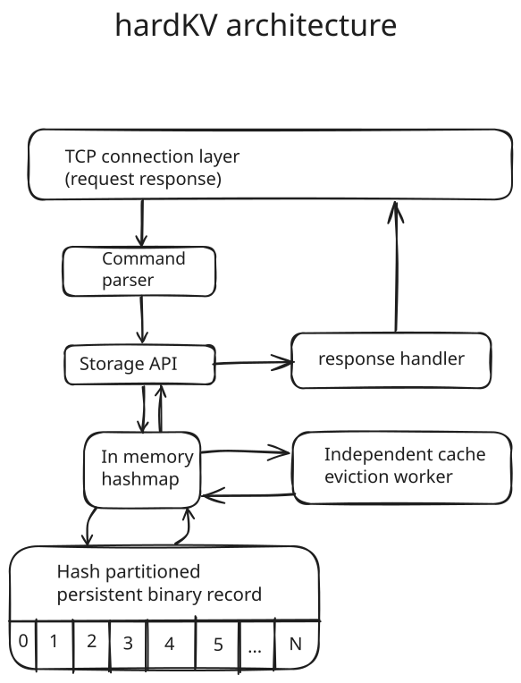

# HardKV
**A persistent key-value system with first-class caching and storage.**

hardKV is a key value database with cache and append-only persistent records written in C, designed around the idea that in-memory caching and persistent storage deserve equal architectural importance.

Unlike architectures where persistence supplements an in-memory store or caching supplements a persistent database, hardKV treats both as fundamental components of the system. 


## Setup
```bash
$ git clone git@github.com:smsadat1/hardKV.git
$ cd hardKV
$ sudo ./setup.sh
```

## Commands

### Identity 

| Auth | Command                       | Purpose                    
|------| ------------------------------|----------------------------------------------------
|   A  | `CREATE <username> <password>`| Create a new user
|   A  | `ALTER <username> <password>` | Change password
|   A  | `DROP <username>`             | Delete a user
|   N  | `AUTH <username> <password>`  | Send credentials for authentications

**Important**
- `A` means admin only
- `N` means no authentication required
- `Y` means authentication required
- `admin` is the default user created during initial setup

### Operations

| Auth | Command                       | Purpose                    
|------| ------------------------------|----------------------------------------------------
|   Y  | `SET <key> <value>`           | Store/update a key with persistence
|   Y  | `SETEX <key> <ttl> <value>`   | Stores only in memory with TTL     
|   Y  | `GET <key>`                   | Retrieve a value           
|   Y  | `DELETE <key>`                | Remove a persistent key               
|   Y  | `EVICT <key>`                 | Remove persistent entry only from cache
|   Y  | `EXIST <key>`                 | Check whether a key exists 
|   Y  | `EXPIRE <key>`                | Remove persistent key immediately
|   Y  | `EXPIRE <key> <ttl>`          | Remove persistent key after added ttl
|   Y  | `TTL <key>`                   | Get TTL of memory only entry
|   Y  | `LIST <prefix>`               | Get key values from cache with pattern match
|   Y  | `STAT`                        | Status                     
|   N  | `PING`                        | PING PONG             

**Important**
- Using `SET` over a key after `SETEX` makes entry persistent 
- Using `SETEX` over a key after `SET` has no effect on persistent disk record but only affects cache record
- When `SETEX` used after `SET` for a key, cache only operations like `TTL` & `EXPIRE` will only affect cache record
- When `SETEX` used after `SET` for a key, `EVICT` will not succeed till cache record expires


## Configurations
Configuration is stored in:

```text
/etc/systemd/
└── system/
    └── hardkv.conf

/etc/hardkv/
├── hardkv.ini
└── users/
    ├── admin.conf
    ├── ...
    └── <user>.conf
```


## Architecture
**Architecture diagram**


## Design Notes
- **First-class caching:** Efficient in-memory access with configurable eviction policies.
- **First-class persistence:** Append-only, partitioned binary storage designed for persistent data.
- **Independent lifecycles:** Cache eviction does not imply persistent data deletion.
- **Concurrent access:** Bucket-specific cache synchronization and partition-specific disk synchronization.
- **Explicit data management:** Cache eviction and persistent deletion are distinct operations.
